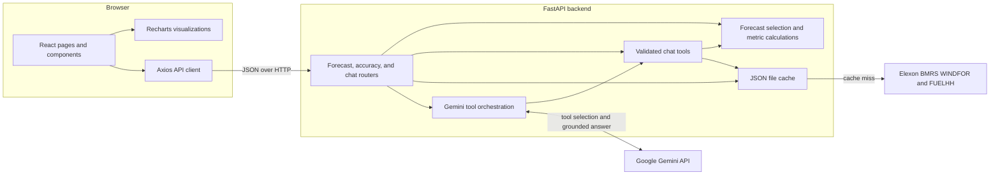
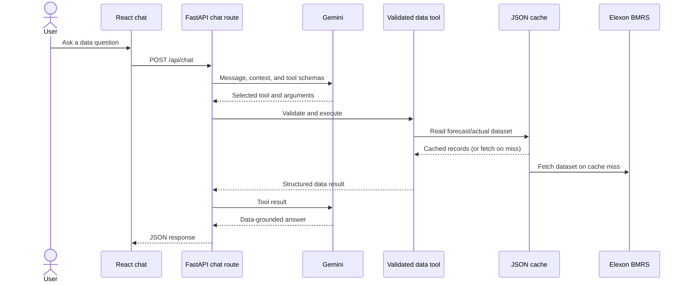

# GridSight

GridSight is a React + FastAPI pilot for a UK utility team making day-ahead electricity purchasing decisions. It uses national wind generation data from Elexon BMRS to help the team answer two questions:

1. What is the latest available wind generation outlook for the delivery day?
2. How much historical forecast error should be considered before committing to the market?

The homepage is intentionally product-led and explanation-first. Forecast charts and detailed analysis live in the Forecast Explorer and Accuracy Analysis routes rather than being forced into the landing page.

## Product surface

- `/` — product introduction and entry points into the analysis workflow.
- `/forecast` — delivery-date forecast explorer with latest vs day-ahead generation, revisions, and CSV export.
- `/accuracy` — 24-hour-ahead MAE, RMSE, bias, lead-time analysis, and actual-vs-forecast comparison.
- `/methodology` — data sources, forecast selection logic, accuracy definitions, and limitations.

## Architecture



The frontend owns navigation, interaction, and visualization. FastAPI owns data retrieval, caching, forecast selection, matching, and accuracy calculations. The JSON cache is shared by dashboard routes and chat tools, so repeated requests reuse the same fetched datasets. Gemini can select from three validated tools; forecast-versus-actual questions can request the forecast and measured actual for the same exact delivery interval in one tool result. Tool results ground the final answer.



Accuracy metrics match forecasts and actuals on the exact `startTime`. The evaluation uses the latest forecast available at least 24 hours before delivery; forecast records published on 31 December 2025 are included to cover the first January delivery day.

## Repository map

```text
.gitignore                  Excludes local keys, caches, build output, and dependencies
docker-compose.yml          Local full-stack orchestration and configurable ports
README.md                   Product, architecture, setup, API, and validation notes

backend/
├── Dockerfile               Backend container image
├── requirements.txt         Python dependencies
├── main.py                  FastAPI app, CORS, startup cache warm-up
├── routers/                 Forecast, accuracy, and chat endpoints
├── services/
│   ├── elexon_client.py     WINDFOR and FUELHH API integration
│   ├── data_processor.py    Forecast selection and accuracy calculations
│   ├── cache.py             File-based response cache
│   ├── chat_tools.py        Validated forecast, accuracy, and revision tools
│   └── llm_service.py       Gemini function-calling orchestration
└── models/schemas.py        API data models

backend/tests/
├── test_chat_tools.py       Tool, Gemini-flow, and API compatibility tests
└── test_cache.py            Empty-response and persistent-cache behavior
backend/.dockerignore        Keeps local credentials, caches, and virtualenv out of images

frontend/src/
├── App.jsx                  Router and application shell
├── pages/                   Overview, Forecast, Accuracy, Methodology
├── components/              Navigation, charts, chatbot, states, tables
├── api/client.js            Axios API client
└── index.css                Product visual system and responsive layout
frontend/package.json        JavaScript dependencies and scripts
frontend/index.html          App entry HTML and page metadata
frontend/Dockerfile          Production build and Nginx image
frontend/nginx.conf          SPA routing and static asset caching
frontend/.dockerignore       Excludes local dependencies and build output

submission/video-demo-script.md  Timed 2-part walkthrough script
```

## Run locally

### Prerequisites

- Python 3.10 or newer
- Node.js 20 or newer and npm
- Docker Compose v2, if using the container workflow
- A Gemini API key only if you want to use the optional chatbot

### Docker

```bash
docker compose up --build
```

- Frontend: http://localhost:3000
- Backend: http://localhost:8000
- API docs: http://localhost:8000/docs

If those ports are occupied, set `BACKEND_PORT=8001 FRONTEND_PORT=3001 VITE_API_URL=http://localhost:8001` before running Compose. The UI then opens at http://localhost:3001.

The optional chat service reads `GEMINI_API_KEY` from `backend/.env` when that file exists. Start from `backend/.env.example`; forecast and accuracy views do not require a Gemini key. The frontend reads `VITE_API_URL` from `frontend/.env` and defaults to `http://localhost:8000`.

The chat request gives Gemini a concise runtime context and three allowlisted native tools: `get_forecast`, `get_accuracy`, and `get_forecast_revisions`. A normal answer uses one Gemini request; a data-backed answer uses a tool-selection request followed by a grounded answer request. Tool arguments are validated with Pydantic, relative dates use `Europe/London`, and tools reuse the existing January 2026 cache and calculation functions. Unsupported dates, missing records, and invalid arguments produce structured unavailable results instead of invented values.

## Tests and build

Run the backend unit tests:

```bash
cd backend
python -m unittest discover -s tests -v
```

Build the frontend production bundle:

```bash
cd frontend
npm ci
npm run build
```

The backend tests cover cache behavior, forecast and accuracy tools, validation, tool dispatch, Gemini handoff and serialization, chat response compatibility, and empty Gemini final responses. They use local fixtures and mocks; they do not require a Gemini key or a live Elexon request.

### Without Docker

```bash
cd backend
python -m venv .venv
source .venv/bin/activate
pip install -r requirements.txt
uvicorn main:app --reload --port 8000
```

In another terminal:

```bash
cd frontend
npm install
npm run dev
```

Set `VITE_API_URL=http://localhost:8000` in `frontend/.env` when the frontend is not using its default API URL.
Use `backend/.env.example` and `frontend/.env.example` as the starting points for local environment files.

## API endpoints

| Method | Endpoint | Purpose |
|---|---|---|
| GET | `/` | Health check |
| GET | `/api/forecast/latest?date=YYYY-MM-DD` | Latest and day-ahead forecast by delivery period |
| GET | `/api/forecast/history` | Forecast records grouped by publication time |
| GET | `/api/accuracy/summary` | January 2026 MAE, RMSE, bias, and matched count |
| GET | `/api/accuracy/by-leadtime` | Accuracy by lead-time bucket |
| GET | `/api/accuracy/actuals-vs-forecast` | Matched forecast/actual points for comparison |
| POST | `/api/chat` | Optional analysis assistant |

## Data sources and scope

- Actual generation: [Elexon BMRS FUELHH](https://bmrs.elexon.co.uk/api-documentation/endpoint/datasets/FUELHH/stream), filtered to `fuelType=WIND`.
- Forecast generation: [Elexon BMRS WINDFOR](https://bmrs.elexon.co.uk/api-documentation/endpoint/datasets/WINDFOR/stream), using `startTime`, `publishTime`, and `generation`. Forecasts published on 31 December 2025 are fetched for January 1 delivery.
- Evaluation window: January 2026 only.

The product deliberately does not infer total procurement requirements from wind alone. Demand, other generation sources, prices, and portfolio constraints are outside this challenge scope.

## Data coverage and limitations

The January accuracy sample matches forecast and actual records by exact `startTime`. WINDFOR is hourly while FUELHH actuals are half-hourly, so metrics include only common delivery timestamps. Periods without an actual or without a forecast available by the 24-hour cutoff are excluded; the matched count exposes this coverage. The supported delivery window is January 2026. The product does not infer procurement requirements from wind alone; demand, other generation, prices, and portfolio constraints are outside scope.

## AI assistance

AI tools were used during implementation for code exploration, interaction design iteration, and frontend/backend development support. The final product decisions, data interpretation, and code review remain the responsibility of the implementer.

## Deployment status

This workspace contains the Dockerized sample application and local run instructions. Public GitHub, Vercel/Heroku, and YouTube URLs should be added here after publishing with the submitter's accounts.
